# 💼 TrampoJovem — Sistema de Vagas e Candidaturas (Estágio & Jovem Aprendiz)

<div align="center">


**Plataforma Web Completa para Conectar Estudantes e Empresas no Primeiro Emprego**  
*Desenvolvido no âmbito do Simulado Programa Centelha 3 Rondônia (Edital nº 03/2026)*

[🌐 Acessar Sistema Local](http://localhost:3011) • [📄 Ver Catálogo de Telas](http://localhost:3011/catalogo_com_prints.html) • [⬇️ Baixar PDF Oficial](./TRAMPOJOVEM_CATALOGO_VISUAL_COM_PRINTS.pdf)

</div>

---

## 👨‍💻 Ficha de Identificação Acadêmica

| Campo | Detalhe |
|---|---|
| **Estudante Desenvolvedor:** | **Gabriel Pereira Pantoja** |
| **Turma / Curso:** | 3º B – Técnico em Informática |
| **Instituição:** | IFRO — Instituto Federal de Rondônia (Campus Calama) |
| **Componente Curricular:** | Desenvolvimento de Sistemas |
| **Metodologia:** | *Spec-Driven Development* (Baseada no Edital nº 03/2026 Centelha) |
| **Repositório Oficial:** | [github.com/pereirapantojagabriel-wq/desenvolvimento-de-sistema-gb](https://github.com/pereirapantojagabriel-wq/desenvolvimento-de-sistema-gb) |

---

## 💡 Sobre o Projeto

O **TrampoJovem** é uma plataforma web completa desenvolvida para cadastro, divulgação, candidatura e acompanhamento de oportunidades de **Estágio** e **Jovem Aprendiz**. O sistema resolve o problema da falta de centralização e transparência nos processos seletivos de jovens em Rondônia, permitindo que estudantes criem seu currículo, busquem vagas com filtros e se candidatem com 1 clique, enquanto empresas publicam oportunidades e realizam a triagem com alteração de status em tempo real.

---

## 📸 Catálogo Visual Completo de Telas (Prints Reais)

### Tela 01 — Landing Page Institucional / Vitrine de Vagas Abertas
> **Módulo:** Público / Oportunidades (`/index.html`)  
> **Descrição:** Portal de entrada do sistema com proposta de valor, banner visual moderno, atalhos de demonstração rápida (1 clique) e filtros dinâmicos de busca por palavra-chave, modalidade (*Estágio* ou *Aprendiz*) e localidade.

<div align="center">
  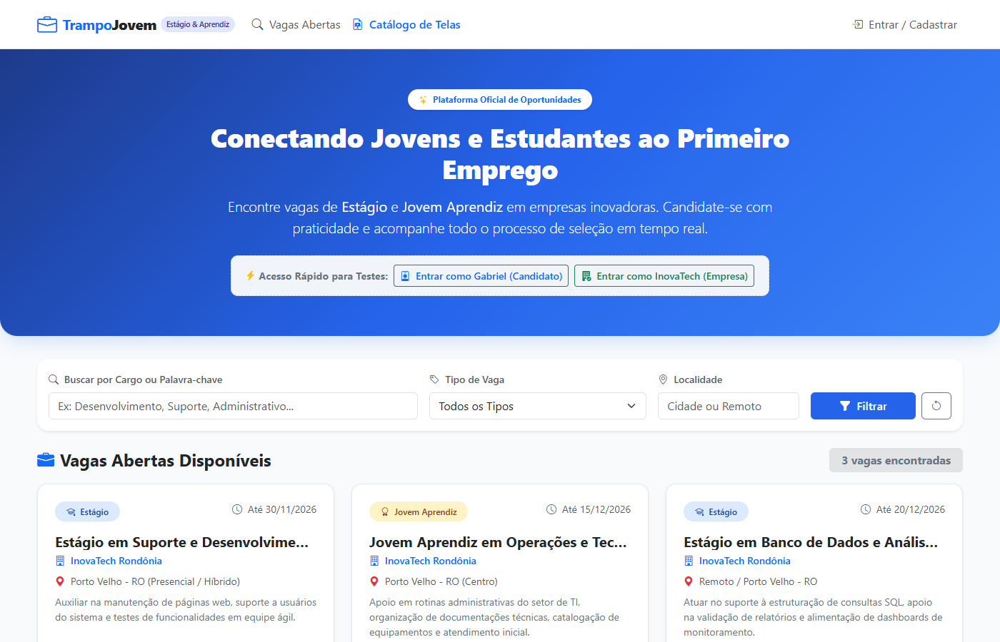
</div>

---

### Tela 02 — Modal Interativo de Detalhes da Vaga & Candidatura
> **Módulo:** Processo Seletivo / Candidatura  
> **Descrição:** Modal dinâmico aberto ao clicar em qualquer vaga. Exibe atribuições completas, requisitos técnicos, prazo limite de candidatura e botão inteligente de inscrição com prevenção contra candidaturas duplicadas.

<div align="center">
  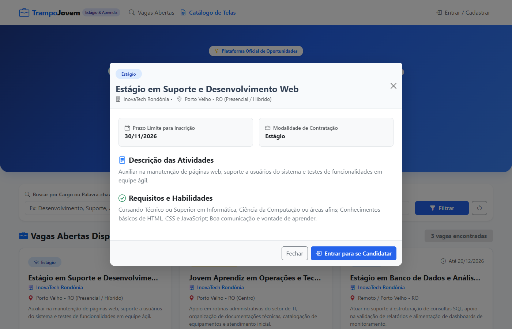
</div>

---

### Tela 03 — Modal / Tela de Autenticação Unificada (Login)
> **Módulo:** Autenticação & Segurança (`/login.html`)  
> **Descrição:** Interface de acesso seguro com validação de credenciais de e-mail e senha por hash **bcrypt**, emissão de token JWT, atalho de acesso rápido para as contas de teste e link de recuperação de senha.

<div align="center">
  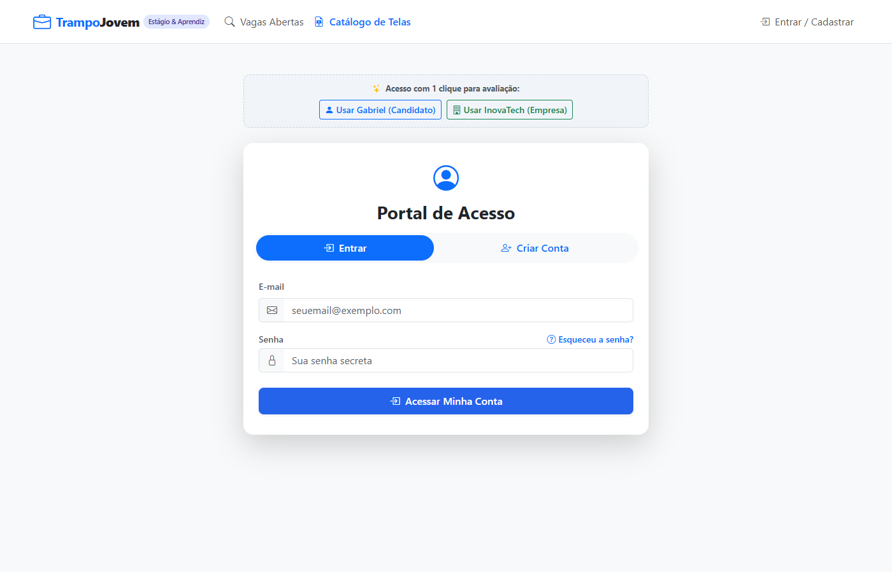
</div>

---

### Tela 04 — Tela de Cadastro de Novo Usuário (Candidato ou Empresa)
> **Módulo:** Autenticação & Controle de Acesso (`/cadastro.html`)  
> **Descrição:** Formulário de registro com seletor interativo de perfil (*Candidato* vs *Empresa*), validação rígida de senha no servidor, bloqueio de e-mails duplicados e campos específicos para estudantes (turma, escolaridade e habilidades).

<div align="center">
  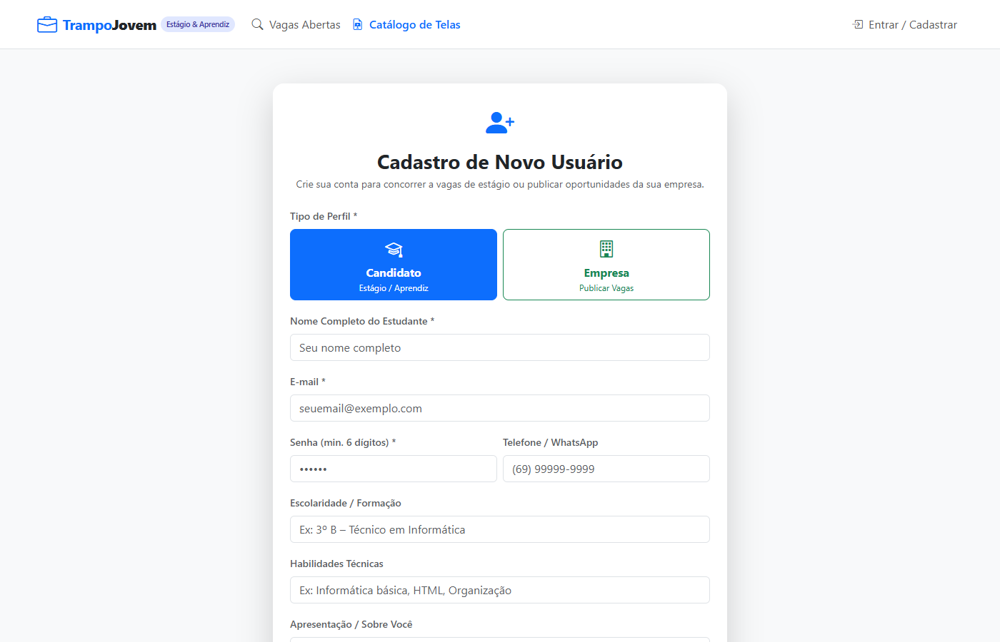
</div>

---

### Tela 05 — Tela de Recuperação de Senha & Redefinição de Acesso
> **Módulo:** Segurança & Autoatendimento (`/recuperar-senha.html`)  
> **Descrição:** Módulo em duas etapas para recuperação de conta: envio de código de verificação de 6 dígitos e formulário para cadastro imediato da nova senha criptografada.

<div align="center">
  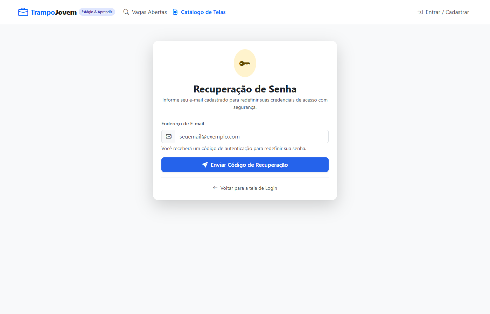
</div>

---

### Tela 06 — Painel do Candidato: Edição de Perfil & Dados Pessoais
> **Módulo:** Perfil do Estudante / Gestão de Currículo (`/candidato-perfil.html`)  
> **Descrição:** Área privativa onde o estudante edita seus dados cadastrais, telefone/WhatsApp de contato, curso/turma (ex.: *3º B – Técnico em Informática*), lista de habilidades técnicas e texto de apresentação pessoal (bio).

<div align="center">
  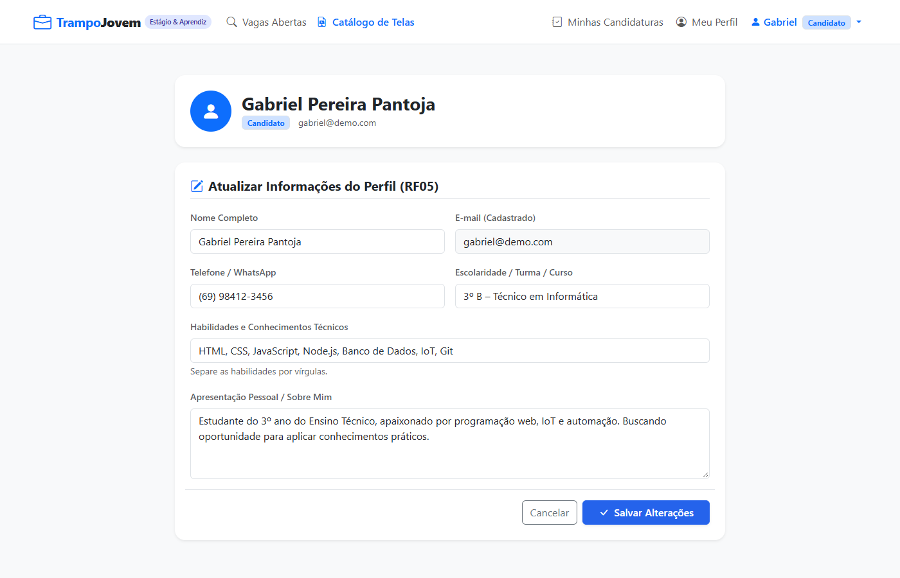
</div>

---

### Tela 07 — Painel do Candidato: Minhas Candidaturas & Status
> **Módulo:** Acompanhamento do Aluno (`/candidato-candidaturas.html`)  
> **Descrição:** Tabela com todas as vagas em que o candidato se inscreveu, informando empresa, modalidade, data da inscrição e badges coloridas com o andamento do processo: ⏳ *Em análise*, ✅ *Aprovado* ou ❌ *Reprovado*.

<div align="center">
  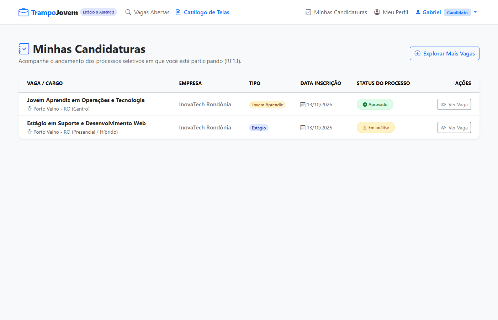
</div>

---

### Tela 08 — Painel Administrativo da Empresa: Dashboard de Vagas
> **Módulo:** Gestão Corporativa / Administrativo (`/empresa-vagas.html`)  
> **Descrição:** Dashboard da empresa com cards de métricas em tempo real (*Total de Vagas*, *Vagas Abertas* e *Total de Inscritos*), tabela de oportunidades, botão de publicação, edição de dados e encerramento/reabertura de vagas.

<div align="center">
  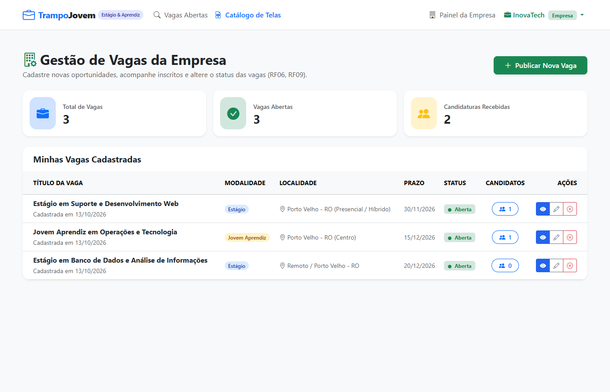
</div>

---

### Tela 09 — Modal de Publicação e Edição de Vagas
> **Módulo:** Cadastro & Edição de Oportunidades  
> **Descrição:** Formulário modal para inclusão ou alteração de vagas. Permite definir título, modalidade (*Estágio* ou *Jovem Aprendiz*), localidade, prazo limite, descrição das atividades e requisitos técnicos.

<div align="center">
  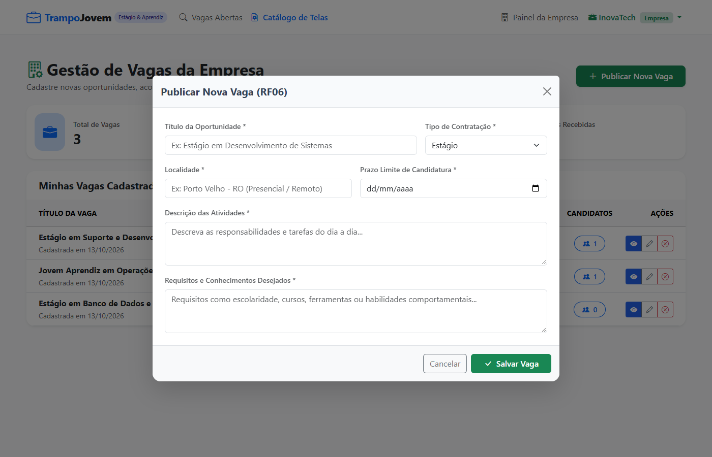
</div>

---

### Tela 10 — Gestão, Triagem e Decisão de Candidatos por Vaga
> **Módulo:** Triagem de Talentos / RH (`/empresa-candidatos.html`)  
> **Descrição:** Área de decisão do recrutador. Para a vaga selecionada, exibe o currículo completo de cada jovem inscrito com contato, escolaridade, tags de habilidades e apresentação, com alteração de status em 1 clique (*Em análise*, *Aprovado*, *Reprovado*).

<div align="center">
  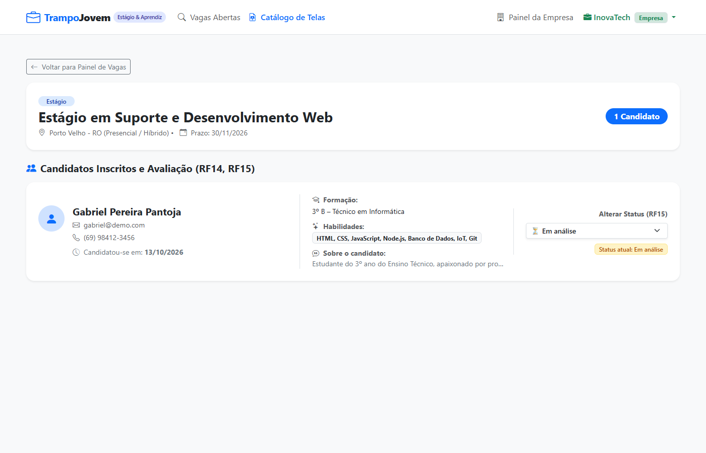
</div>

---

## 🗄️ Modelo de Dados (DER)

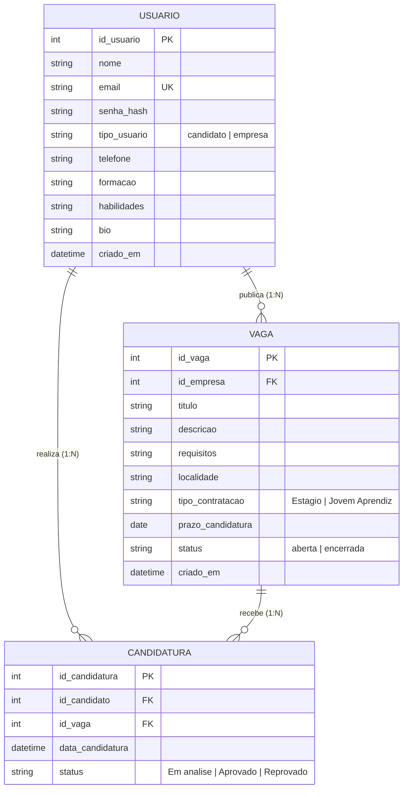

---

## 📋 Matriz de Requisitos Funcionais e Status

| Requisito | Caso de Uso | Descrição | Onde foi implementado | Status |
|:---:|:---:|---|---|:---:|
| **RF01** | UC01 | Cadastro de usuário com perfil (candidato ou empresa) | `authController.js` & `cadastro.html` | ✅ Concluído |
| **RF02** | UC02 | Login com validação por e-mail e senha segura | `authController.js` & `login.html` | ✅ Concluído |
| **RF03** | — | Bloqueio automático de e-mails duplicados | `authController.js` (Unique constraint) | ✅ Concluído |
| **RF04** | — | Encerramento de sessão (logout seguro) | `authController.js` & `api.js` | ✅ Concluído |
| **RF05** | UC03 | Atualização de perfil e currículo do candidato | `userController.js` & `candidato-perfil.html` | ✅ Concluído |
| **RF06** | UC04 | Publicação de vaga contendo todos os atributos | `jobController.js` & `empresa-vagas.html` | ✅ Concluído |
| **RF07** | UC05 | Consulta pública de vagas abertas com filtros | `jobController.js` & `index.html` | ✅ Concluído |
| **RF08** | UC06 | Visualização de detalhes completos da vaga em modal | `jobController.js` & modal em `index.html` | ✅ Concluído |
| **RF09** | UC11 | Edição e encerramento/reabertura de vagas | `jobController.js` & `empresa-vagas.html` | ✅ Concluído |
| **RF10** | UC07 | Candidatura de estudante a vaga aberta com 1 clique | `applicationController.js` & `index.html` | ✅ Concluído |
| **RF11** | — | Impedimento de candidatura duplicada | `applicationController.js` (Unique key) | ✅ Concluído |
| **RF12** | — | Registro com data e status inicial "Em análise" | `applicationController.js` & SQLite | ✅ Concluído |
| **RF13** | UC08 | Painel "Minhas Candidaturas" com badges de status | `applicationController.js` & `candidato-candidaturas.html` | ✅ Concluído |
| **RF14** | UC09 | Consulta dos candidatos inscritos por vaga | `applicationController.js` & `empresa-candidatos.html` | ✅ Concluído |
| **RF15** | UC10 | Alteração de status (Em análise, Aprovado, Reprovado) | `applicationController.js` & `empresa-candidatos.html` | ✅ Concluído |

---

## 🔑 Contas Demo Pré-configuradas (1 Clique)

| Tipo de Perfil | Nome / Identificação | E-mail | Senha |
|---|---|---|---|
| **Candidato (Estudante)** | Gabriel Pereira Pantoja (*3º B Informática*) | `gabriel@demo.com` | `123456` |
| **Empresa / Administrador** | InovaTech Rondônia | `empresa@demo.com` | `123456` |

---

## 🛠️ Tecnologias e Arquitetura

- **Backend:** Node.js v22 com Express.js 5.x.
- **Banco de Dados:** SQLite Relacional persistente via `better-sqlite3` com `PRAGMA foreign_keys = ON` e integridade referencial.
- **Segurança:** Senhas criptografadas com `bcryptjs` (salt rounds = 10), autenticação stateless por JSON Web Tokens (JWT) e validação no servidor (RNF01, RNF02, RNF03).
- **Frontend:** HTML5 semântico, CSS3 personalizado ([`style.css`](public/css/style.css)), JavaScript ES6 modular ([`api.js`](public/js/api.js)), Bootstrap 5.3 e Bootstrap Icons.
- **Automação:** Captura de telas e geração de documentos via `puppeteer-core` e `docx`.

---

## 🚀 Como Executar o Projeto Localmente

1. **Clone o repositório:**
   ```bash
   git clone https://github.com/pereirapantojagabriel-wq/desenvolvimento-de-sistema-gb.git
   cd desenvolvimento-de-sistema-gb
   ```

2. **Instale as dependências:**
   ```bash
   npm install
   ```

3. **Inicie o servidor:**
   ```bash
   npm start
   ```

4. **Acesse no seu navegador:**  
   👉 **[http://localhost:3011](http://localhost:3011)**

---

<div align="center">
  <sub>TrampoJovem &copy; 2026 — Desenvolvido por Gabriel Pereira Pantoja · IFRO Campus Calama</sub>
</div>
