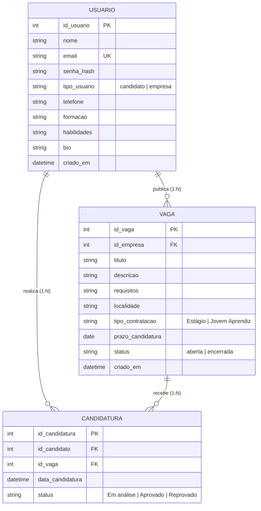

# 📋 Especificação Técnica Final (Spec Final) — TrampoJovem

**Sistema de Divulgação, Cadastro e Gerenciamento de Vagas de Estágio e Jovem Aprendiz**  
*Desenvolvido no âmbito do Simulado Programa Centelha 3 Rondônia / IFRO Campus Porto Velho Calama*

- **Autor:** Gabriel Pereira Pantoja (3º B – Técnico em Informática)  
- **Professor Orientador:** Prof. Rafael Pitwak  
- **Componente Curricular:** Desenvolvimento de Sistemas  
- **Repositório GitHub:** [https://github.com/pereirapantojagabriel-wq/desenvolvimento-de-sistema-gb](https://github.com/pereirapantojagabriel-wq/desenvolvimento-de-sistema-gb)  
- **Sistema Publicado no Ar (Vercel):** [https://desenvolvimento-de-sistema-gb-este.vercel.app](https://desenvolvimento-de-sistema-gb-este.vercel.app)  

---

## 1. Objetivo do Sistema
O **TrampoJovem** é uma plataforma web para cadastro, divulgação e gerenciamento de vagas de estágio e jovem aprendiz, permitindo que estudantes criem uma conta, consultem vagas disponíveis com filtros dinâmicos e realizem candidaturas com um clique. Empresas ou administradores podem cadastrar oportunidades, gerenciar prazos e acompanhar e triar os candidatos recebidos, alterando o status dos processos seletivos com transparência.

---

## 2. Usuários e Perfis de Acesso

### Candidato (Estudante / Jovem Aprendiz)
- Criar conta e realizar login seguro.
- Atualizar perfil acadêmico, formação, habilidades técnicas e apresentação pessoal (RF05).
- Consultar a vitrine de vagas abertas com filtros de busca (RF07).
- Visualizar os detalhes completos de uma oportunidade em modal interativo (RF08).
- Candidatar-se a vagas abertas com trava contra duplicidade (RF10, RF11).
- Consultar suas candidaturas e acompanhar o status em tempo real (*Em análise*, *Aprovado*, *Reprovado*) (RF13).

### Empresa / Administrador
- Fazer login seguro.
- Cadastrar novas vagas com título, modalidade, localidade, prazos e requisitos (RF06).
- Editar dados de vagas já cadastradas e encerrar/reabrir oportunidades (RF09).
- Visualizar o dashboard geral com métricas de vagas e candidatos recebidos.
- Consultar a lista de candidatos que se inscreveram em suas vagas (RF14).
- Atualizar o status da candidatura (*Em análise*, *Aprovado*, *Reprovado*) (RF15).

---

## 3. Casos de Uso Principais
- **UC01 — Cadastrar usuário:** Registro de candidato ou empresa com e-mail único.
- **UC02 — Realizar login:** Autenticação com e-mail e senha por hash seguro (Bcrypt).
- **UC03 — Atualizar perfil do candidato:** Edição de dados curriculares e habilidades.
- **UC04 — Cadastrar vaga:** Inclusão de oportunidade por empresa autenticada.
- **UC05 — Consultar vagas disponíveis:** Busca na vitrine com filtros de modalidade e local.
- **UC06 — Visualizar detalhes de uma vaga:** Modal com atribuições, requisitos e prazos.
- **UC07 — Candidatar-se a uma vaga:** Registro de inscrição de candidato autenticado.
- **UC08 — Consultar minhas candidaturas:** Painel do estudante com badges de status.
- **UC09 — Consultar candidatos de uma vaga:** Listagem de currículos inscritos.
- **UC10 — Atualizar status de candidatura:** Deferimento ou indeferimento do candidato.
- **UC11 — Editar ou encerrar uma vaga:** Gestão do ciclo de vida da oportunidade.

---

## 4. Requisitos Funcionais (RF)
- **RF01:** O sistema deve permitir que um novo usuário cadastre nome, e-mail, senha e tipo de usuário (`candidato` ou `empresa`).
- **RF02:** O sistema deve permitir login utilizando e-mail e senha cadastrados.
- **RF03:** O sistema deve impedir o cadastro de dois usuários com o mesmo e-mail (rejeição com HTTP 409).
- **RF04:** O sistema deve permitir que o usuário autenticado encerre sua sessão (logout).
- **RF05:** O sistema deve permitir que o candidato altere seus dados de perfil (formação, telefone, habilidades e bio).
- **RF06:** O sistema deve permitir que empresa/administrador cadastre uma vaga contendo título, descrição, requisitos, localidade, tipo de contratação (*Estágio* ou *Jovem Aprendiz*) e prazo de candidatura.
- **RF07:** O sistema deve permitir que usuários consultem a lista de vagas abertas com filtros.
- **RF08:** O sistema deve permitir que o usuário visualize os detalhes de uma vaga aberta.
- **RF09:** O sistema deve permitir que empresa/administrador edite ou encerre uma vaga cadastrada.
- **RF10:** O sistema deve permitir que um candidato autenticado se candidate a uma vaga aberta.
- **RF11:** O sistema deve impedir que o mesmo candidato se candidate duas vezes à mesma vaga.
- **RF12:** O sistema deve registrar a candidatura relacionando o candidato à vaga com data e status inicial **"Em análise"**.
- **RF13:** O sistema deve permitir que o candidato consulte suas candidaturas e visualize seus status.
- **RF14:** O sistema deve permitir que empresa/administrador consulte as candidaturas recebidas para uma vaga.
- **RF15:** O sistema deve permitir que empresa/administrador altere o status da candidatura (*Em análise*, *Aprovado* ou *Reprovado*).

---

## 5. Requisitos Não Funcionais (RNF)
- **RNF01 — Segurança de senha:** As senhas nunca são armazenadas em texto puro; utiliza-se hash seguro **Bcrypt** com salt rounds = 10.
- **RNF02 — Validação no servidor:** Todo formulário é validado no backend Node.js antes de ser persistido.
- **RNF03 — Autenticação:** Rotas restritas exigem autenticação via token JWT (JSON Web Token) com checagem de papéis (`candidato` vs. `empresa`).
- **RNF04 — Integridade:** Banco de dados relacional com chaves primárias, estrangeiras e restrição `UNIQUE` composta.
- **RNF05 — Desempenho:** Resposta das consultas principais em menos de 1 segundo.
- **RNF06 — Usabilidade:** Interface simples, semântica, com notificações visuais Toast e badges acessíveis.
- **RNF07 — Responsividade:** Layout fluido adaptável para celulares, tablets e computadores via Bootstrap 5.3.
- **RNF08 — Disponibilidade e Persistência:** Dados salvos em banco relacional estruturado.

---

## 6. Modelo de Dados (DER)

### Diagrama Entidade-Relacionamento


---

## 7. Decisão de Stack e Deploy
- **Frontend:** HTML5, CSS3, JavaScript ES6+ modular, Bootstrap 5.3 e Bootstrap Icons.
- **Backend:** Node.js v22 com framework Express 5.
- **Banco de Dados:** SQLite 3 via driver nativo C++ `better-sqlite3` com fallback em memória resiliente para ambientes de nuvem.
- **Deploy em Produção:** Vercel Serverless ([https://desenvolvimento-de-sistema-gb-este.vercel.app](https://desenvolvimento-de-sistema-gb-este.vercel.app)).
- **Controle de Versão:** Git e GitHub.

---

# 8. Guia de Instalação e Execução (Passo a Passo)

Esta seção foi concebida para permitir que qualquer avaliador clone o projeto em um computador virgem e o coloque em execução sem necessidade de suporte externo.

### 8.1 Ambiente Exigido
- **Linguagem / Runtime:** Node.js versão **20.x** ou **22.x** (acompanhado do `npm` versão 10+).
- **Servidor Local:** Servidor Express embutido disparado pelo comando `npm start`.
- **Bibliotecas e Dependências:** Gerenciadas via `package.json` (`express`, `bcryptjs`, `jsonwebtoken`, `cookie-parser`, `better-sqlite3`, `dotenv`).
- **Comando de Instalação:** `npm install`.
- **Sistemas Operacionais Testados:**
  - Windows 10 / 11 (PowerShell e CMD)
  - Linux Ubuntu 22.04 LTS
  - Vercel Serverless Linux Container (Amazon Linux 2)

---

### 8.2 Banco de Dados

- **SGBD:** SQLite 3 (banco relacional em arquivo local).
- **Nome do Banco:** `database.sqlite` (criado automaticamente na raiz do projeto).
- **Script SQL Oficial:** [`database/schema.sql`](database/schema.sql).
- **Como Executar o Script SQL:**
  - **Automático:** O próprio backend executa e semeia o banco na primeira inicialização (`npm start`).
  - **Manual (Opcional via terminal):** Caso deseje criar ou resetar pelo terminal SQLite:
    ```bash
    sqlite3 database.sqlite < database/schema.sql
    ```

#### Tabela de Descrição das Entidades e Relacionamentos:

| Tabela | Campos Principais | Chave Primária | Relacionamentos (Chaves Estrangeiras) |
|---|---|:---:|---|
| **USUARIO** | `id_usuario`, `nome`, `email`, `senha_hash`, `tipo_usuario`, `telefone`, `formacao`, `habilidades`, `bio` | `id_usuario` | — *(Entidade independente)* |
| **VAGA** | `id_vaga`, `id_empresa`, `titulo`, `descricao`, `requisitos`, `localidade`, `tipo_contratacao`, `prazo_candidatura`, `status` | `id_vaga` | `id_empresa` → `USUARIO.id_usuario` (ON DELETE CASCADE) |
| **CANDIDATURA** | `id_candidatura`, `id_candidato`, `id_vaga`, `data_candidatura`, `status` | `id_candidatura` | `id_candidato` → `USUARIO.id_usuario`<br>`id_vaga` → `VAGA.id_vaga`<br>*(Constraint UNIQUE composta em `id_candidato` + `id_vaga`)* |

#### Dados Iniciais (Seeds)
O script [`database/schema.sql`](database/schema.sql) já insere automaticamente:
1. Uma empresa de teste: **InovaTech Rondônia** (`empresa@demo.com` / senha `123456`).
2. Um estudante de teste: **Gabriel Pereira Pantoja** (`gabriel@demo.com` / senha `123456`).
3. Três vagas abertas: *Estágio em Suporte e Desenvolvimento Web*, *Jovem Aprendiz em Operações e Tecnologia* e *Estágio em Banco de Dados*.
4. Uma candidatura inicial de teste do Gabriel com status **"Em análise"**.

---

### 8.3 Variáveis de Ambiente (`.env`)

O repositório inclui o arquivo de modelo [`.env.example`](.env.example):

```env
PORT=3011
JWT_SECRET=coloque-uma-chave-secreta-aqui
NODE_ENV=development
```

#### Explicação de cada variável:
- `PORT`: Define a porta TCP onde o servidor web Node.js escutará localmente (padrão do projeto: `3011`).
- `JWT_SECRET`: Chave secreta de segurança utilizada pela biblioteca `jsonwebtoken` para assinar e validar os tokens de sessão. Pode ser qualquer string alfanumérica segura.
- `NODE_ENV`: Define o modo de execução (`development` para depuração local ou `production` em nuvem).

---

### 8.4 Passo a Passo de Instalação Local (Numerado)

Siga os passos exatos abaixo no terminal do seu computador:

1. **Clonar o repositório do GitHub:**
   ```bash
   git clone https://github.com/pereirapantojagabriel-wq/desenvolvimento-de-sistema-gb.git
   ```

2. **Entrar na pasta do projeto:**
   ```bash
   cd desenvolvimento-de-sistema-gb
   ```

3. **Instalar as dependências do Node.js:**
   ```bash
   npm install
   ```

4. **Configurar as variáveis de ambiente:**
   - No Windows (PowerShell):
     ```powershell
     Copy-Item .env.example .env
     ```
   - No Linux / macOS:
     ```bash
     cp .env.example .env
     ```

5. **Iniciar o servidor da aplicação:**
   ```bash
   npm start
   ```

6. **Acessar o sistema no navegador:**  
   Abra o navegador de sua preferência e acerte o endereço:  
   👉 **`http://localhost:3011`**

---

### 8.5 Como Testar o Sistema (Roteiro do Fluxo Principal)

#### Contas de Teste Pré-configuradas:
| Perfil de Acesso | E-mail de Teste | Senha Padrão |
|---|---|---|
| **Candidato (Estudante):** | `gabriel@demo.com` | `123456` |
| **Empresa (Recrutador):** | `empresa@demo.com` | `123456` |

*(A tela de login conta com botões de atalho de 1 clique que preenchem as credenciais automaticamente).*

#### Roteiro de Teste do Fluxo Principal:
1. **Vitrine e Busca:** Acesse `http://localhost:3011` e use a barra de busca para filtrar vagas por termo (ex: "Desenvolvimento") ou modalidade ("Estágio").
2. **Visualizar Vaga:** Clique em **"Ver Detalhes & Candidatar"** em qualquer card para inspecionar os requisitos completos em modal interativo.
3. **Candidatura como Estudante:**
   - Faça login com a conta de **Gabriel** (`gabriel@demo.com`).
   - Volte à vitrine e clique em **"Candidatar-se Agora"** na vaga *Jovem Aprendiz*.
   - Observe a notificação verde de sucesso confirmando a inscrição com status inicial **"Em análise"**.
   - Tente clicar novamente: o sistema bloqueia e avisa que a candidatura já foi feita (RF11).
4. **Minhas Candidaturas:** No menu superior, clique em **"Minhas Candidaturas"** para ver a lista das vagas com badges coloridas.
5. **Triagem pela Empresa:**
   - Faça logout e entre com a conta da **InovaTech** (`empresa@demo.com`).
   - O sistema abrirá o **Painel da Empresa** exibindo os contadores de vagas e o botão de candidatos.
   - Clique em **"Ver Candidatos"** da vaga correspondente para inspecionar o currículo de Gabriel.
   - No seletor de status, altere de *Em análise* para **"Aprovado"**.
6. **Confirmação:** Faça logout, entre novamente como Gabriel e verifique no painel de candidaturas que o status foi atualizado para **"Aprovado"** em tempo real.

#### Limitações Conhecidas:
- Em instâncias de nuvem puramente *serverless* sem volume anexado, o banco SQLite opera em memória mantendo os dados enquanto durar o ciclo da função. Para implantações empresariais de grande escala, recomenda-se configurar um banco PostgreSQL gerenciado externo (ex.: Neon Postgres ou Supabase).
